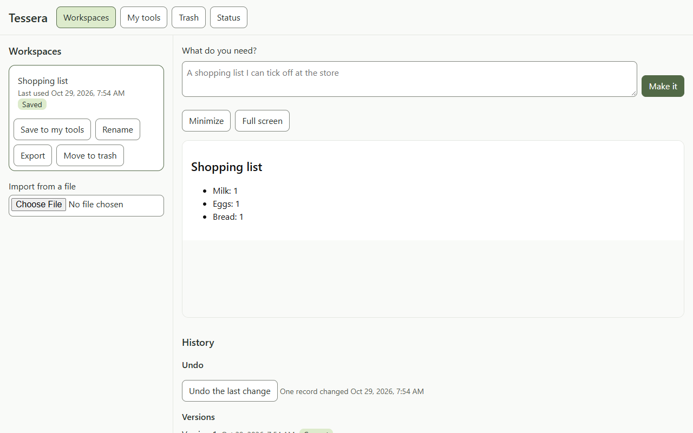
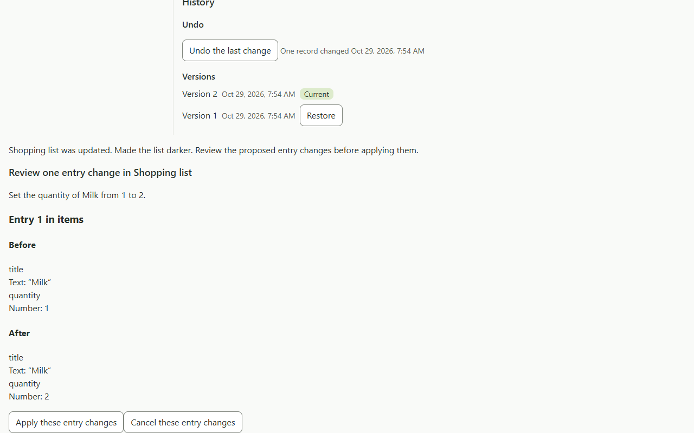
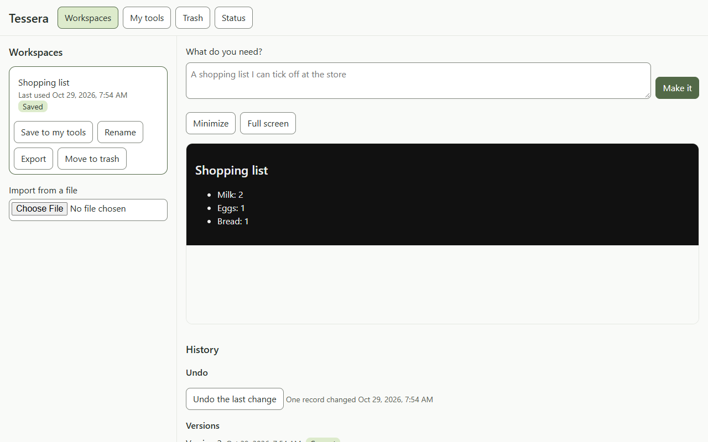

# Chat data: live check, 2026-10-29

The owner explicitly approved one run capped at three calls: two expected data plans and one shared schema/shape repair reserve, with no reviewer calls. Both required cases passed in two calls; no repair, failed, refused or unknown-usage calls occurred. The unused reserve does not authorize another run. Product and runner head: `8e30cd466feab17bf92e9b52b442f22616fe2960`. Script: `evals/spikes/chat-data-check/run.ts` ([code doc](../../docs/code/evals/chat-data-check.md)). Intent, initial shopping fixture and style edit were scripted; only data planning could reach Claude Haiku 5.5 at low effort. This is narrow integrated evidence for GEN-04 and DATA-02, not intent accuracy or general interface generation.

| Required case | Observed result |
| --- | --- |
| Add Bread quantity 1 | Milk/Eggs retain their IDs and quantities; Bread receives a host ID; visible rows show Milk 1, Eggs 1, Bread 1 on the original white background. No tool version created. |
| Darken and set Milk quantity 2 | Style activates first with background #111111 and text #eeeeee. Actual host review shows Milk changing from 1 to 2, with Apply and Cancel visible; persisted data remains unchanged before approval. After the runner clicks Apply, Milk 2, Eggs 1 and Bread 1 render with all three IDs retained. One tool version created; HTML, JavaScript and data declarations retained. |

The browser run took 16.2 seconds. The two model calls used 6,866 input tokens (including cache creation; 2,453 read from cache), 358 output tokens and 4.848 seconds model time. Both used `data-plan@2ce101112867`, `request@47a51319da7d`, `language@2a8e10d77d23` and `data-context@f23d03154e01`. The [sanitized call ledger](2026-10-29-chat-data-check/ledger.jsonl) retains allowlisted call, prompt-part and usage facts, excluding provider/session metadata. M2 spending is now 20 of its approved envelope of about 35 calls.

# Evidence and replay

The exact free rehearsal immediately before the live run passed 2/2 cases with two fake calls in 6.946 seconds on the same head: `test-output/evals/chat-data-check-dry-run-2026-10-29T10-53-54-682Z/`. Live outputs are under `test-output/evals/chat-data-check-live-2026-10-29T10-54-23-743Z/`, including the report, request log, screenshots and browser video. Those local raw outputs remain ignored.

The three unchanged viewport PNGs below were visually inspected. They establish the add result, concrete review and approved mixed result respectively:

The [portable replay](../spikes/chat-data-check/replays/chat-data-check-2026-10-29.json) contains only the two parsed structured answers plus case/request and run/head/call-index provenance. It excludes CLI envelopes, sign-in and session metadata. The deterministic test in `evals/test/chat-data-check.test.ts` validates each answer through the actual planner and temporary storage: initial activation, add with host-generated ID, style activation, unchanged entries while replacement awaits explicit commit, then Milk 2 with all IDs/titles retained. The replay uses no provider or model calls; browser approval behavior is evidenced by the live runner.

# Limits

Full-page screenshots are supplementary only: nested runtime content can shrink, clip or disappear despite visible-row assertions (L-76). They were not used to claim visual success here. No tool controls, cancellation/conflict cases, live intent, edit generation or repair prompt were evaluated. This successful run found no new defect; it does not close broader replay or preservation work. No repeat live run was made.
