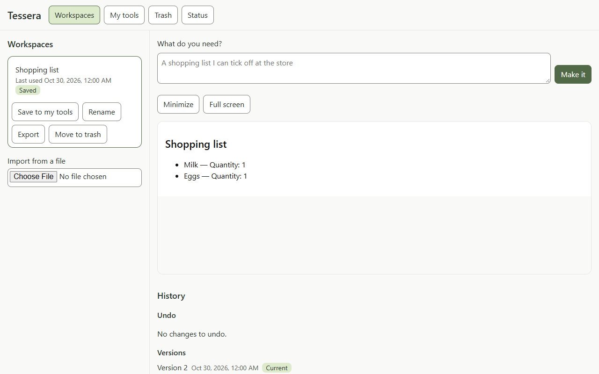

# Bridge edit: live check, 2026-10-30

The owner explicitly approved one run capped at two calls: one expected Sonnet 5.5 low edit and one shared schema/static/smoke repair reserve, with zero reviewer calls. The one required case passed in one call; there were no repair, failed, refused or unknown-usage calls. The unused reserve authorizes no repeat. Product and runner head: `d900a427ddf4bbd7fb234b2ab69b0645dc765b09`, with a clean source tree. The [runner](../../docs/code/evals/bridge-edit-check.md) used a handwritten saved fixture and scripted behavioral intent; only the edit could reach the model. This is narrow positive bridge-prompt evidence for ENG-16 and integrated edit/data-preservation evidence for GEN-07 and DATA-03.

| Required case | Observed result |
| --- | --- |
| Add numeric quantity 1 beside every item, keeping the original white shopping list | One activation added one tool version and one data revision. Workspace identity/title, IDs `i-1`/`i-2`, titles Milk/Eggs, white colors and unordered list layout remained. Both entries gained only quantity 1. The host reported that Shopping list was updated. |

The browser run took 13.149 seconds (10.06 seconds for the case). The model used 9,845 input tokens, zero cached input, 514 output tokens and 3.965 model seconds. Its actual edit StageSpec included `bridge@63eefdc4fb28`; all part versions and usage are retained in the [allowlisted ledger](2026-10-30-bridge-edit-check/ledger.jsonl). M2 spending is now 21 of its approved envelope of about 35 calls.

# Evidence and replay

The immediately preceding exact free rehearsal passed 1/1 with one fake edit call in 6.378 seconds on clean `b60ba875f2c912d695adfb9a34469c42d3a4370e`. The final live source differs only in documentation. Raw ignored rehearsal output is `test-output/evals/bridge-edit-check-dry-run-2026-10-30T02-46-45-134Z/`; live output is `test-output/evals/bridge-edit-check-live-2026-10-30T02-59-59-384Z/` in the evaluation checkout. Request envelopes, browser video, data folder and full captures stay ignored.

The unchanged viewport PNG below was visually inspected: Shopping list, Milk and Eggs with quantity 1, white background and list layout are visible. Its SHA-256 is `21a426fd8433b43e78da0def86c07bfa6090491569662921e7b6d2233dd9202c` (43,034 bytes); the committed copy was byte-checked against the original.

The [portable replay](../spikes/bridge-edit-check/replays/bridge-edit-check-2026-10-30.json) extracts only the parsed structured answer from call 0, plus run/head/case/request provenance. It excludes the CLI/session envelope. UTF-8 extraction and round-trip comparison preserve the model's JavaScript, including its em dash. The deterministic regression in `evals/test/bridge-edit-check.test.ts` parses the actual answer, runs `editedCandidate` with the original `editFixture` through the actual static bridge guard, and applies `migrateData` to entries and reusable defaults. It checks lossless quantity addition, stable IDs/titles, unchanged source, HTML/CSS and capabilities, schema version 2 and the appended migration history. Activation/version/revision facts come from the live runner; the offline test does not replay browser activation.

# Limits

Full-page captures are supplementary under L-76 and were not used to claim visual success. No generated controls were operated. Live intent, creation, repairs and negative bridge-error cases were not exercised; static/unit, smoke and migration evidence cover separate parts of the behavior. This run does not sign off broad VER-01: startup writes and system-clock checks remain follow-up work, while the inherited obfuscated global-object alias gap remains an accepted defence-in-depth limit in the [static-check doc](../../docs/code/server/checks.md). No new defect was found, no guard was weakened and no additional live call was made.
